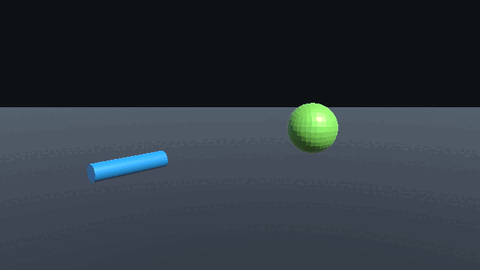

# Vacuum

Vacuum is a dependency-free Unity Package Manager package for stylized mesh suction.
Add `SuctionAbsorbable` to a mesh target, drive a nozzle with `SuctionSource`, and
pull targets into a single point with a 5-state lifecycle.



## Requirements

- Unity `6000.4` or newer
- No package dependencies beyond `UnityEngine`

## Package Contents

| Path | Contents |
| --- | --- |
| `Runtime/` | Runtime API: `SuctionSource`, `SuctionAbsorbable`, `SuctionContext`, `SuctionMotionProfile`, and `ISuctionTarget`. |
| `Samples~/BasicVacuum/` | Importable sample with a nozzle, varied targets, and a simple input driver. |
| `Tests/Editor/` | EditMode tests for source lifecycle, target states, acquisition, categories, and interruption. |
| `Documentation~/media/vacuum-demo.gif` | Lightweight animated capture of the suction deformation. |
| `README.md` | Full English README. |
| `README.ja.md` | Japanese README. |
| `llms.txt` | AI-agent oriented navigation for high-signal docs and source files. |
| `CHANGELOG.md` | Version history. |
| `LICENSE.md` | MIT license. |

## Basic Workflow

1. Add `SuctionAbsorbable` to a mesh object with a `MeshFilter`.
2. Add a `Collider` if the target should be discovered by `SuctionSource`.
3. Add `SuctionSource` to the nozzle object.
4. Choose `Raycast` for direct reticle-style suction, or `Volume` for Point/Spot
   area suction.
5. Build a `SuctionContext` from your controller each frame and call
   `SuctionSource.Tick(ctx)`.
6. Tune the `MotionProfile` on the nozzle to control speed, curve/spiral motion,
   vortex, stretch, snap, and shake.

## Minimal Driver

```csharp
using UnityEngine;
using Vacuum;

[RequireComponent(typeof(SuctionSource))]
public sealed class MyNozzle : MonoBehaviour
{
    [SerializeField] Camera aimCamera;
    [SerializeField] float power = 1f;
    [SerializeField] float maxDistance = 30f;

    SuctionSource source;

    void Awake()
    {
        source = GetComponent<SuctionSource>();
    }

    void Update()
    {
        bool held = Input.GetMouseButton(0);
        Ray aim = aimCamera.ScreenPointToRay(Input.mousePosition);

        var ctx = new SuctionContext(
            transform,
            transform.position,
            aim,
            power,
            maxDistance,
            held);

        source.Tick(ctx);
    }
}
```

## Samples

Import **Basic Vacuum Demo** from the Package Manager Samples tab. In Play Mode,
hold the left mouse button and aim at a target. Release during suction to see the
`Backflow` interruption path.

## Japanese Documentation

See `README.ja.md` for the Japanese package guide.
